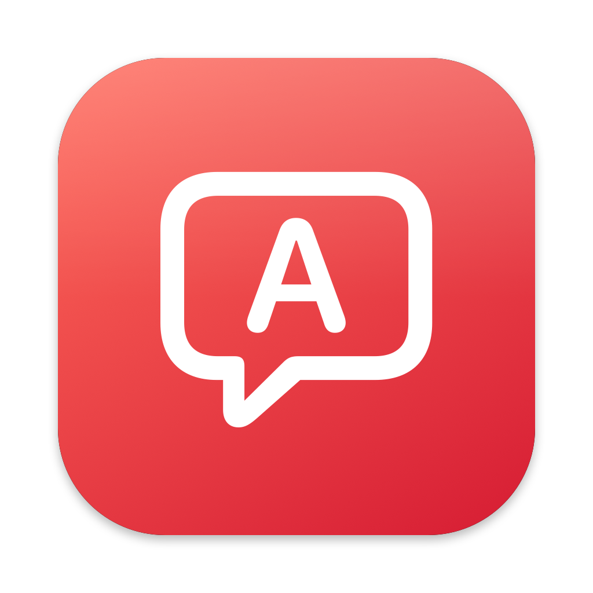
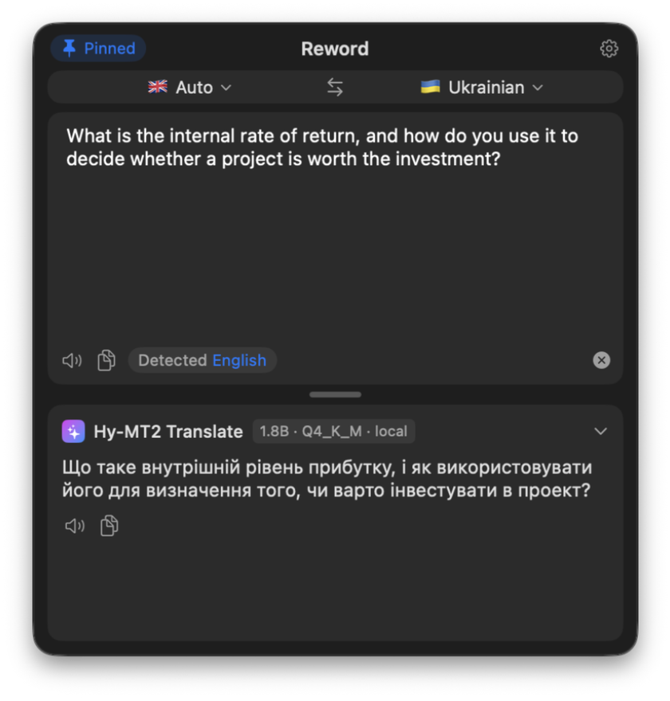
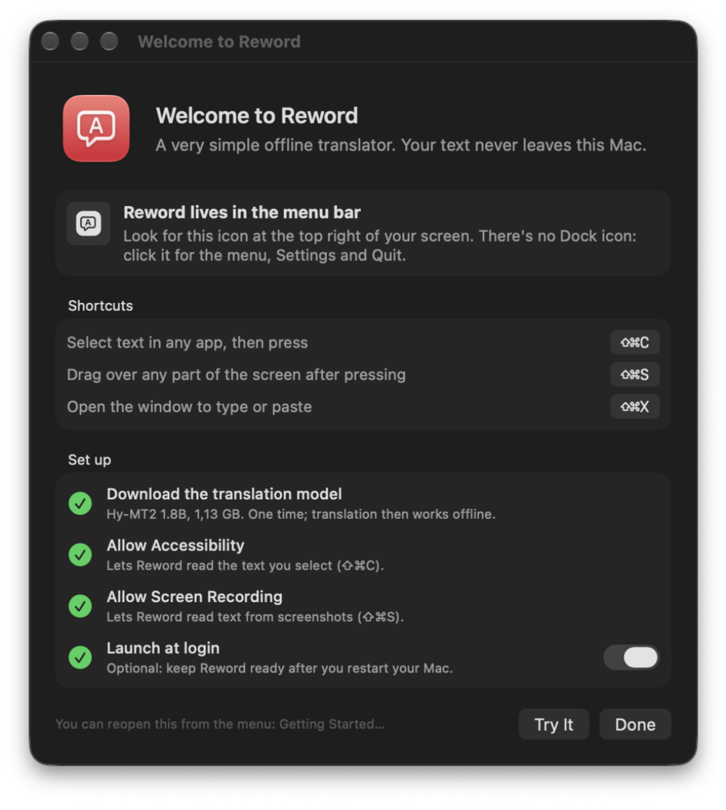
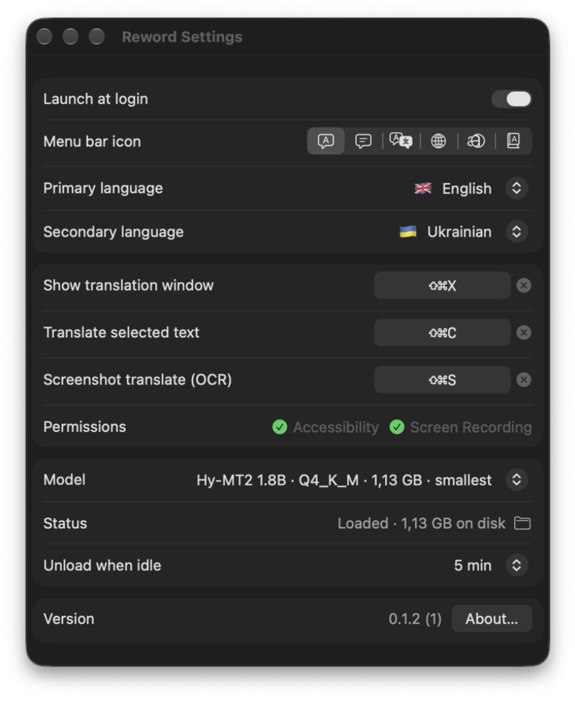
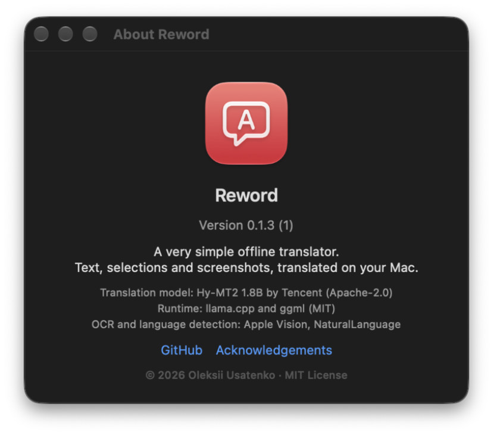

<p align="center"></p>

# Reword

**A very simple offline translator for your Mac.** Select text, snap a screenshot or just type, and get the
translation in a small window, without your words ever leaving the computer.

- **Text** in **33 languages** plus 5 regional languages and dialects, translated by a local AI model.
- **Screenshots** read with on-device OCR in **29 languages**, then translated.
- **Offline and private.** No accounts, no API keys, no cloud services. After a one-time model download,
  Reword works without an internet connection.

<p align="center">
  
</p>

## How it works

| Shortcut | What it does |
| --- | --- |
| **⌘⇧C** | Translates the text selected in any app |
| **⌘⇧S** | Drag over any part of the screen; Reword reads the text in it and translates it |
| **⌘⇧X** | Opens the translation window to type or paste text |

Shortcuts can be changed in Settings.

- **Translates as you type.** No button to press; Return translates immediately.
- **Picks the direction for you.** Like Google Translate, Reword remembers the languages you use and translates
  into the most recent one that isn't the text's own language — so English goes to Ukrainian, Ukrainian back
  to English, and a new pick in the window becomes the new default. It starts from your Mac's language list.
- **Stays out of the way.** It lives in the menu bar. The window hides when you switch apps, or you can pin
  it next to your work. It remembers its size and position.
- **Small touches:** read aloud, copy, launch at login, and the model unloads from memory when idle.

<p align="center">
  
</p>

<p align="center">
  
  
</p>

## Languages

**Translation (33):** Arabic, Bengali, Burmese, Chinese (Simplified), Chinese (Traditional), Czech, Dutch,
English, Filipino, French, German, Gujarati, Hebrew, Hindi, Indonesian, Italian, Japanese, Khmer, Korean,
Malay, Marathi, Persian, Polish, Portuguese, Russian, Spanish, Tamil, Telugu, Thai, Turkish, Ukrainian,
Urdu, Vietnamese. Also Cantonese, Kazakh, Mongolian, Tibetan and Uyghur.

**Screenshot OCR (29):** Arabic, Cantonese, Chinese (Simplified and Traditional), Czech, Danish, Dutch,
English, Finnish, French, German, Hindi, Indonesian, Italian, Japanese, Korean, Malay, Marathi, Norwegian
(Bokmål and Nynorsk), Polish, Portuguese, Romanian, Russian, Spanish, Swedish, Thai, Turkish, Ukrainian,
Vietnamese.

## Requirements

- Mac with Apple silicon, macOS 26 or later
- About 1.1 GB of disk space for the translation model (downloaded automatically on first launch)
- Accessibility access to read selected text, Screen Recording access for screenshots

## Under the hood

Reword runs [tencent/Hy-MT2-1.8B](https://huggingface.co/tencent/Hy-MT2-1.8B), a dedicated translation
model (Apache-2.0), through [llama.cpp](https://github.com/ggml-org/llama.cpp) on the Mac's GPU. Choose the
Q4_K_M (1.1 GB, default), Q6_K (1.5 GB) or Q8_0 (1.9 GB) quantization in Settings. Text recognition uses
Apple's Vision framework, and language detection uses Apple's NaturalLanguage framework, both on-device.
The only network request Reword makes is downloading the model, once, on first launch (or when you pick
a different quantization). Models are stored in
`~/Library/Application Support/com.ou.Reword/Models/`.

## Build from source

Requirements: Xcode 26 or later.

```bash
scripts/install.sh              # fetches llama.cpp b11655 (checksum-verified), builds, installs /Applications/Reword.app
open /Applications/Reword.app
```

Command line, using the same engine:

```bash
/Applications/Reword.app/Contents/MacOS/Reword --translate "Hello world" --to uk
```

## Releases

Running the **Release** workflow manually (Actions › Release › Run workflow, version `1.0.0`) builds the app on a macOS runner,
signs it with a Developer ID Application certificate (hardened runtime, secure timestamp), packages
`Reword-1.0.0.dmg`, notarizes and staples it, and publishes it with its SHA-256 to GitHub Releases.

The job runs in the protected `release` environment: only `main` can deploy to it, each run waits for
an owner's approval, and a tag ruleset stops `v*` tags from being moved or deleted. Keep the
signing secrets as **environment** secrets of `release`, not repository secrets.

Secrets used by the workflow:

| Secret | Value |
| --- | --- |
| `DEVELOPER_ID_P12_BASE64` | Developer ID Application certificate and private key exported as .p12, base64-encoded |
| `DEVELOPER_ID_P12_PASSWORD` | Password of that .p12 |
| `NOTARY_KEY_P8_BASE64` | App Store Connect API key (.p8), base64-encoded |
| `NOTARY_KEY_ID` | Key ID of that API key |
| `NOTARY_ISSUER_ID` | Issuer ID from App Store Connect › Users and Access › Integrations |

The same script runs locally: `scripts/release.sh 1.0.0` signs with the first Developer ID identity in
your keychain and notarizes when `NOTARY_PROFILE` (a `notarytool store-credentials` profile) or the API
key variables are set.

## Support Reword

Reword is free and open source. If it saves you time, you can support its development with a tip via
[Revolut](https://revolut.me/to_oleksii). Thank you!

## License

MIT. The Hy-MT2 model is licensed separately under Apache-2.0 by Tencent.
